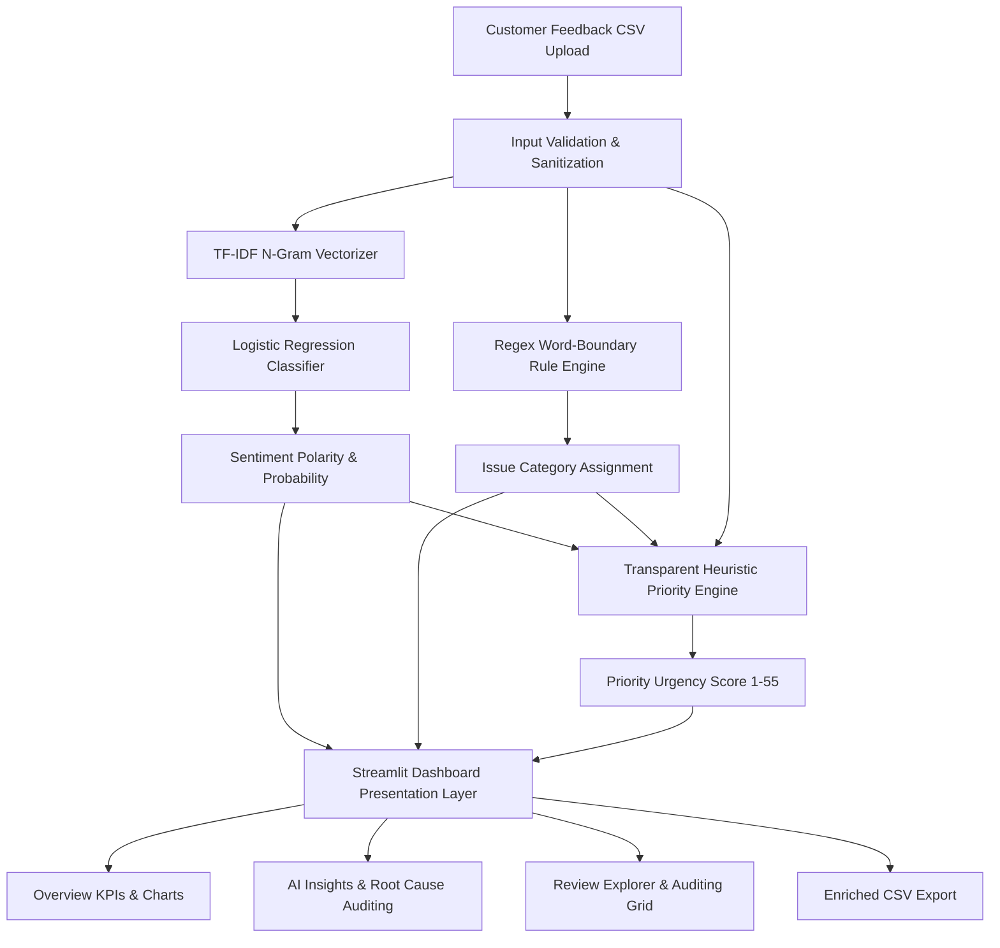

# Revio InsightOps AI 🔎

<p align="center">
  <strong>Turn customer reviews into evidence-backed operational actions.</strong>
</p>

<p align="center">
  <a href="https://revio-insightops-ai.streamlit.app/"></a>
  <a href="https://github.com/Bhishant/revio-insightops-ai"></a>
  <a href="https://zenodo.org/records/18723813"></a>
  
  
  
</p>

---

## 📌 Executive Overview

**Revio InsightOps AI** is an AI/ML customer feedback intelligence and operational decision-support system developed by **Bhishant Sharma** for the **Cynbit** technical assessment portfolio.

Organizations routinely receive thousands of unstructured customer reviews across support tickets, review aggregators, and digital touchpoints. Sifting through this volume manually creates severe cognitive overload: critical complaints regarding billing discrepancies, safety concerns, or fulfillment failures get buried beneath routine commentary.

Revio InsightOps AI bridges this gap with an auditable, high-throughput dual-engine architecture:
1. **Supervised Machine Learning Pipeline**: Sublinear TF-IDF n-gram vectorization combined with L2-regularized Logistic Regression to classify sentiment polarity (*Positive*, *Neutral*, *Negative*) and calculate confidence probabilities.
2. **Transparent Rule Engines**: Deterministic regex pattern matching for 5 key operational issue domains, paired with a transparent priority scoring heuristic strictly bounded between 1 and 55.
3. **Human-in-the-Loop Decision Support**: An interactive Streamlit dashboard providing macro KPI visibility, thematic root-cause drilldowns, individual review auditing, and exportable CSV workflows.

> 🌐 **Live Web Application**: [https://revio-insightops-ai.streamlit.app/](https://revio-insightops-ai.streamlit.app/)  
> 📂 **Source Code**: [https://github.com/Bhishant/revio-insightops-ai](https://github.com/Bhishant/revio-insightops-ai)  
> 📊 **Benchmark Dataset**: [Zenodo Record 18723813](https://zenodo.org/records/18723813)

---

## 🎯 Key Application Capabilities

The live Streamlit application delivers four dedicated analytical modules:

```
┌─────────────────────────────────────────────────────────────────────────────┐
│                           REVIO INSIGHTOPS AI                               │
├─────────────────┬─────────────────┬────────────────────┬────────────────────┤
│  📊 Overview    │  💡 AI Insights │  🔎 Review         │  🧪 Model          │
│     Dashboard   │     Module      │     Explorer       │     Evaluation     │
├─────────────────┼─────────────────┼────────────────────┼────────────────────┤
│ • Macro KPIs    │ • Theme Filter  │ • Multiselect Grid │ • Saved Test Split │
│ • Donut Chart   │ • 3 Worst Quotes│ • Full Search/Sort │ • Macro F1 & Acc   │
│ • Theme Barplot │ • Action Steps  │ • CSV Export       │ • Class Breakdown  │
│ • Triage Flags  │ • Draft Reply   │ • Full Transparency│ • Domain Caveats   │
└─────────────────┴─────────────────┴────────────────────┴────────────────────┘
```

* **📊 Overview Dashboard**: Real-time KPI cards tracking total reviews, negative reviews, high-priority flags ($\ge 40$), and low-confidence predictions ($< 0.55$). Interactive Plotly donut and horizontal bar charts summarize sentiment balance and defect distributions.
* **💡 AI Insights Module**: Translates aggregated metrics into targeted operational actions. Select any issue category to view negative counts, average priority, highest score, verbatim supporting customer review quotes, actionable investigation guidelines, and an editable draft customer response template.
* **🔎 Review Explorer**: Multi-dimensional filtering across sentiment and defect categories. Allows analysts to inspect raw review text, model confidence, rating, branch, and date, with one-click export to `revio_analyzed_reviews.csv`.
* **🧪 Model Evaluation**: In-app governance tab displaying benchmark evaluation metrics measured on 2,870 held-out Yelp test records directly from `models/evaluation_metrics.json`.

---

## 🏗️ System Architecture & Data Flow

Revio InsightOps AI explicitly separates machine learning classification from deterministic rule engines, ensuring total auditability and zero black-box hallucination.



---

## ⚙️ Technical Implementation

### 1. Sentiment Machine Learning Pipeline
* **Feature Extraction**: `TfidfVectorizer` configured with:
  * `lowercase=True`, `strip_accents='unicode'`
  * `ngram_range=(1, 2)` (captures key negations like *"not happy"*, *"never again"*)
  * `min_df=2`, `max_df=0.98`, `max_features=100000`
  * `sublinear_tf=True` (logarithmic term frequency dampening)
  * `stop_words='english'`
* **Classification**: `LogisticRegression` with:
  * `solver='lbfgs'`, `max_iter=1500`
  * `class_weight='balanced'` (penalizes misclassifications inversely proportional to class frequencies)
  * `C=2.0` (L2 inverse regularization strength)
* **Architectural Rationale**: Sub-millisecond CPU inference, zero GPU footprint, full mathematical determinism, and 100% local execution without third-party API dependencies or recurring costs.

### 2. Issue Categorization Engine (`src/core.py`)
Deterministic regex word-boundary pattern matching (`(?<!\w)phrase(?!\w)`) maps feedback into 5 concrete operational domains:
* 🚚 **Delivery**: *courier, late delivery, shipping, takeout, pickup, arrived late, etc.*
* 🛠️ **Product Quality**: *defective, broken, damaged, cold food, raw, undercooked, food poisoning, etc.*
* 🎧 **Customer Support**: *rude staff, poor service, waiter, manager, no response, ignored complaint, etc.*
* 💳 **Billing & Payment**: *overcharged, charged twice, refund, wrong bill, extra charge, expensive, etc.*
* 💻 **App & Website**: *crashes, login error, loading, checkout error, online ordering, etc.*
* 📦 **Other**: Default fallback when no domain keywords match.

### 3. Transparent Priority Scoring Heuristic
A bounded scoring formula designed for operational triage:
$$\text{Priority Score} = \min\left( \text{BaseScore}(\text{Sentiment}) + \text{UrgentBoost} + \text{UnresolvedBoost}, 55 \right)$$

* **BaseScore**: `Negative = 15` \| `Neutral = 5` \| `Positive = 1` *(fallback = 5)*
* **UrgentBoost (+25)**: Matches terms such as *refund, charged twice, fraud, unsafe, food poisoning, allergic reaction, plastic in food, overcharged, broken*.
* **UnresolvedBoost (+15)**: Matches terms such as *ignored, not resolved, several calls, no response, still waiting, no refund*.
* **High Priority Escalation**: Any review scoring $\ge 40$ is automatically flagged as a high-priority incident.

---

## 📈 Benchmark Performance & Evaluation

The model was trained and evaluated on the **Yelp Restaurant Reviews Sentiment Dataset** ([Zenodo 18723813](https://zenodo.org/records/18723813)) across **14,350 curated, usable records** partitioned via an 80/20 stratified split:

* **Training Set**: 11,480 records (80%)
* **Held-Out Test Set**: 2,870 records (20%)

### Overall Metrics (Held-Out Test Split)

| Evaluation Metric | Measured Result | Interpretation |
| :--- | :---: | :--- |
| **Accuracy** | **81.85%** (`0.818467`) | Overall correctly classified test samples |
| **Macro F1-Score** | **0.6951** (`0.695086`) | Balanced, unweighted mean across all 3 classes |
| **Weighted F1-Score** | **0.8193** (`0.819325`) | Support-weighted average reflecting dataset distribution |
| **Evaluation Records** | **2,870** | Independent held-out test split |

### Class-Wise Performance Breakdown

| Class | Precision | Recall | F1-Score | Support | Operational Analysis |
| :--- | :---: | :---: | :---: | :---: | :--- |
| **Positive** | **0.913** | **0.899** | **0.906** | 1,971 | High fidelity driven by distinct, abundant positive vocabulary. |
| **Negative** | **0.766** | **0.806** | **0.785** | 540 | **High operational recall (80.6%)**: captures 435 of 540 complaints for triage. |
| **Neutral** | **0.392** | **0.396** | **0.394** | 359 | Weaker performance due to mixed sentiment in 3-star reviews; identified for future ABSA iteration. |

### Confusion Matrix ($N = 2,870$)

```
                     PREDICTED
                Positive   Neutral   Negative
TRUE  Positive    1,772       150        49
      Neutral       133       142        84
      Negative       35        70       435
```

### Observed Results on Uploaded Yelp Dataset (14,351 Records)
When processing the 14,351 uploaded Yelp records through the live Streamlit dashboard:
* **Analysed Reviews**: 14,351 (100%)
* **Positive Sentiment**: 9,586 (66.8%)
* **Negative Sentiment**: 2,799 (19.5%)
* **Neutral Sentiment**: 1,966 (13.7%)
* **High-Priority Flags ($\ge 40$)**: 76 critical escalations
* **Low-Confidence Predictions ($< 0.55$)**: 1,206 records flagged for human review

---

## 📁 Repository Structure

```
revio-insightops-ai/
├── app.py                                   # Main Streamlit web application & UI
├── train_real_yelp_model.py                 # Pipeline training & evaluation script
├── evaluate_real_reviews.py                 # Standalone benchmark evaluation script
├── requirements.txt                         # Pinned production dependencies
├── README.md                                # Project documentation
│
├── src/
│   ├── __init__.py
│   └── core.py                              # Regex issue categorization & priority heuristic
│
├── tests/
│   ├── __init__.py
│   └── test_core.py                         # Pytest test suite for core heuristics
│
├── models/
│   ├── sentiment_pipeline.joblib            # Serialized TF-IDF + Logistic Regression model
│   └── evaluation_metrics.json              # Serialized held-out test evaluation benchmarks
│
├── data/
│   ├── sample_reviews.csv                   # Built-in demo reviews
│   └── real_yelp_reviews.csv                # Primary Yelp review dataset
│
│
```

---

## 🚀 Quick Start Guide

### Prerequisites
* Python 3.10, 3.11, or 3.12
* Git

### 1. Clone the Repository
```bash
git clone https://github.com/Bhishant/revio-insightops-ai.git
cd revio-insightops-ai
```

### 2. Set Up a Virtual Environment

**Windows PowerShell:**
```powershell
python -m venv .venv
.\.venv\Scripts\Activate.ps1
```

**macOS / Linux:**
```bash
python3 -m venv .venv
source .venv/bin/activate
```

### 3. Install Dependencies
```bash
pip install --upgrade pip
pip install -r requirements.txt
```

### 4. Run the Automated Test Suite
```bash
pytest -v
```

### 5. Launch the Streamlit Application
```bash
streamlit run app.py
```
Open your browser at `http://localhost:8501`.

---

## 🧪 Model Retraining & Evaluation

To retrain the sentiment pipeline and regenerate evaluation metrics:

```bash
# Trains TF-IDF + Logistic Regression on real_yelp_reviews.csv
# Outputs models/sentiment_pipeline.joblib & models/evaluation_metrics.json
python train_real_yelp_model.py

# Optional: Evaluate the trained model independently
python evaluate_real_reviews.py
```

---

## 📄 Comprehensive Project Reports

Two exhaustive, corporate-formatted evaluation reports have been prepared for the Cynbit hiring and technical teams:

1. **AI Opportunity and Business Value Report** (`Revio_InsightOps_AI_Opportunity_Report.docx` / `.pdf`):
   * Focus: Business problem, operational impact, 6-week controlled pilot framework, and ROI measurement.
   * Length: 15 pages.
2. **Technical Approach and Implementation Report** (`Revio_InsightOps_AI_Technical_Report.docx` / `.pdf`):
   * Focus: System architecture, mathematical formulations, training methodology, confusion matrix analysis, and data governance.
   * Length: 18 pages.

---

## 🛡️ Responsible AI & Ethical Considerations

* **Human-in-the-Loop Safeguard**: The system is engineered as an operational copilot. It does not contact customers, issue refunds, or take autonomous actions without human verification.
* **Privacy by Design**: All inference runs locally in-memory. Zero customer reviews are transmitted to external cloud APIs or third-party LLM providers.
* **Transparent Limitations**:
  * Neutral sentiment classification exhibits lower F1 (0.394) due to mixed sentiments in 3-star reviews.
  * Priority scoring is a transparent heuristic, not a financial risk or churn probability.
  * Domain transferability from Yelp restaurant reviews to specialized B2B domains requires validation.

---

## 👤 Developer & Evaluation Contact

* **Developer**: Bhishant Sharma
* **Role / Assessment**: Cynbit AI/ML Engineer Intern Assessment
* **Live Application**: [https://revio-insightops-ai.streamlit.app/](https://revio-insightops-ai.streamlit.app/)
* **GitHub**: [https://github.com/Bhishant/revio-insightops-ai](https://github.com/Bhishant/revio-insightops-ai)
* **Dataset**: [Zenodo DOI 10.5281/zenodo.18723813](https://zenodo.org/records/18723813)
